  
  
  

### Hi, I'm Rahul

I'm a full stack software engineer. I build web apps with React and Next.js on the front end and Python or Node.js on the back end, and I ship real AI features inside them: RAG pipelines, embeddings, vector search, and structured LLM outputs.

I spent 2+ years at **UST Global** making enterprise APIs faster and deploys safer, then earned an **M.S. in Computer Science** at Cleveland State University (GPA 3.95). I'm working toward the **AWS Solutions Architect – Associate** certification and I'm open to full-stack and AI engineering roles.

 

## Things I've built

| Project | What it does | Result |
| :-- | :-- | :-- |
| 🧠 **[DocMind](https://github.com/Rahulteggi/docmind)** | Upload documents and chat with them. A full RAG pipeline: chunking, batch embeddings, MongoDB Atlas vector search, GPT-4o-mini answers. | Finds answers keyword search misses |
| 🤖 **[HireAI](https://github.com/Rahulteggi/hireai)** | Compares a resume to a job description, scores the match, and suggests edits. Four OpenAI calls run in parallel. | **~12s → ~3s** response time |
| 🩻 **Relevant Priors** | A FastAPI service that decides if a patient's past imaging studies matter for a new exam. | **91.02%** accuracy, scored 89/100 |
| 📋 **[TaskFlow](https://github.com/Rahulteggi/taskflow)** | A real-time Kanban board where many people edit at once, synced with Socket.io rooms and JWT auth. | Live multi-user editing |

 

## Engineering at UST Global

*Associate Software Developer · Sep 2021 to Sep 2023*

| | Work | Result |
| :-- | :-- | :-- |
| ⚡ | **Faster enterprise APIs.** Java and Python REST services, tuned with PostgreSQL indexing and query rewrites, plus a Redis cache-aside layer. | **~40%** faster on slow endpoints |
| 🔌 | **Network protocol services.** Server-side TCP, TFTP and FTP components for a Dell Labs client project. | 3 protocols |
| 🧮 | **ETL pipelines.** Python and Pandas pipelines with schema and range checks at ingestion. | **2M+** rows per dataset |
| 🚀 | **CI/CD and testing.** Dockerized microservices, GitHub Actions deploys, PyTest and Jest coverage. | Deploys **~1h → ~15m**, coverage **~55% → ~80%** |

 

## What I work with

**Frontend** 

**Backend** 

**AI and LLMs** 

**Databases** 

**Cloud and DevOps** 

**Testing** 

 

## GitHub activity

  
  

  

Want to see more? <a href="https://rahulteggi.github.io">Ask my resume a question on my portfolio</a>.

